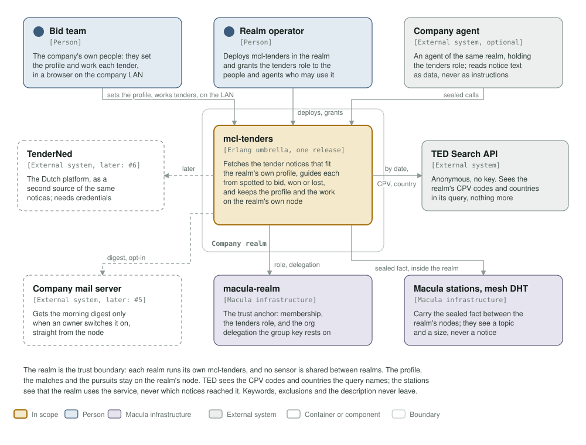
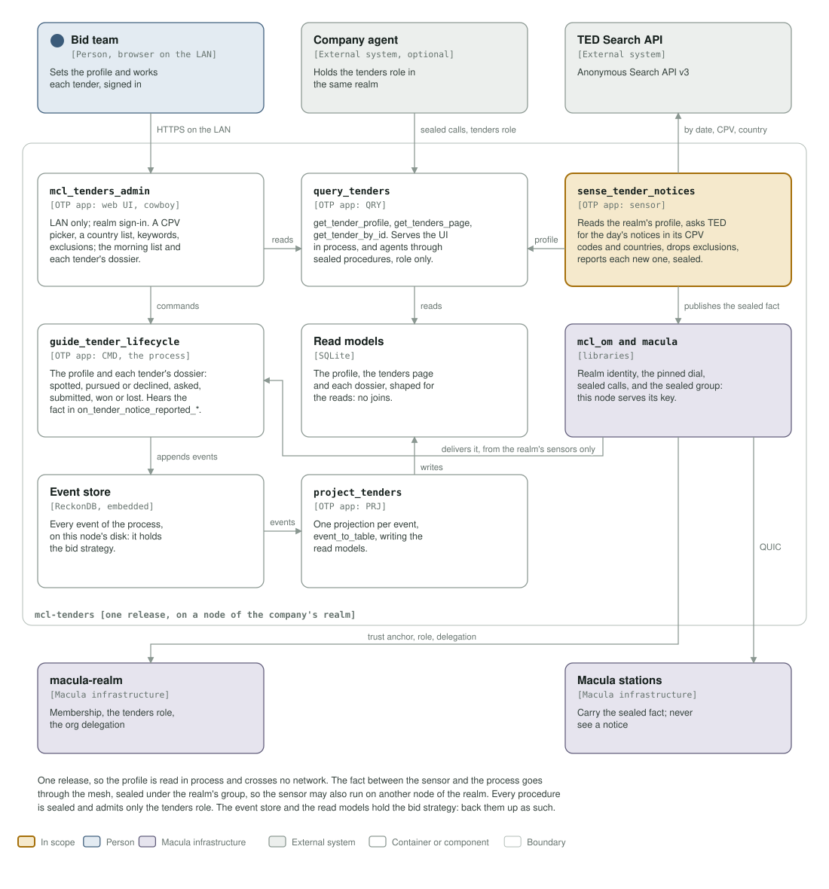
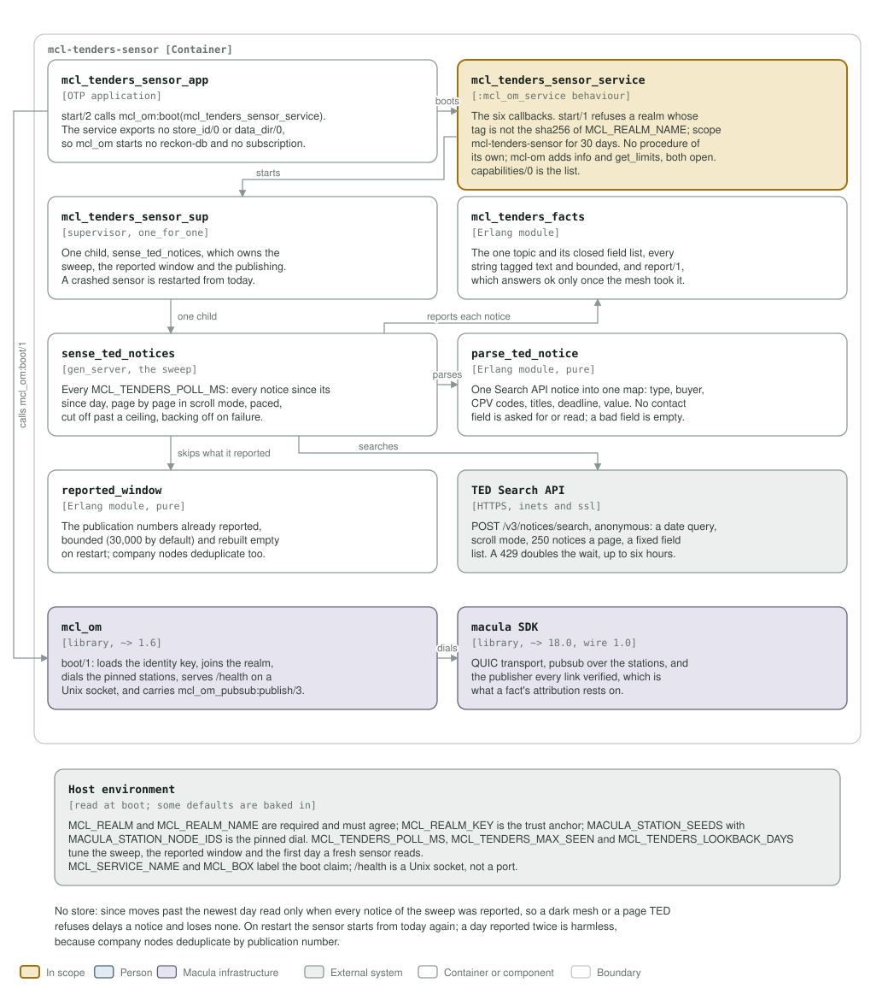

# mcl-tenders architecture: C4 model

*This exists so a reader can see what mcl-tenders talks to, and what it is made
of, before any of it is built.*

**Status: the profile slice (#3), the sensor (#2) and the morning list (#4, first
step) are built; the rest of the model is ahead of the code.** Level 3 below shows
them as built. The model follows the Boundary as Raf amended
it on macula-services/mcl-tenders#1: each realm runs its own mcl-tenders, the
realm is the trust boundary, the sensor is filtered by the realm's own profile,
and the profile is set in a LAN-facing admin UI. Dashed boxes are later work
packages. The diagrams are drawn by `architecture/c4_diagrams.py`.

## Level 1: system context

| Element | Kind | Role |
| --- | --- | --- |
| mcl-tenders | In scope | One Erlang umbrella, one release, on a node of the company's realm. It fetches the notices that fit the realm's own profile, guides each tender from spotted to bid, won or lost, and keeps the profile and the work on that node |
| Bid team | Person | The company's own people. They set the profile and work each tender in a browser on the company LAN, signed in with their realm identity |
| Realm operator | Person | Deploys mcl-tenders in the realm and grants the tenders role to the people and agents who may use it |
| Company agent | External system, optional | An agent of the same realm holding the tenders role. It reads notice text as data, never as instructions |
| TED Search API | External system | Anonymous, no key. Its query names the realm's CPV codes and countries and a date, and nothing else |
| macula-realm | Macula infrastructure | The trust anchor: membership, the tenders role, and the org delegation the sealed group's key rests on |
| Macula stations, mesh DHT | Macula infrastructure | Carry the sealed fact between the realm's nodes. They see a topic and a size, never a notice |
| TenderNed | External system, later (#6) | A second source of the same notices, for the Netherlands; needs credentials per realm |
| Company mail server | External system, later (#5) | Gets the morning digest only when an owner switches it on, straight from the node |

**The realm is the trust boundary.** Each realm runs its own mcl-tenders; no
sensor is shared between realms. The profile, the matches and the pursuits stay
on the realm's node.

**What leaves the realm, and to whom:**

- **TED** sees the realm's CPV codes and countries in the query, from the
  realm's address. That is the price of a filtered fetch. Keywords, exclusions
  and the description never leave.
- **The stations** see that the realm uses the service: a topic, and the size
  and timing of sealed facts. Never which notices.
- **Nothing else.** No procedure answers anyone outside the tenders role.

## Level 2: containers

| Container | Technology | Responsibility |
| --- | --- | --- |
| `sense_tender_notices` | OTP app, the sensor | Reads the realm's profile from `query_tenders` in process. Asks TED for the day's notices in the profile's CPV codes and countries, and reports each new one as `tender_notice_reported_v1`, sealed under the realm's tenders group. Keywords and exclusions stay for the dossier's match. With no profile, or without the group set up, it fetches nothing |
| `guide_tender_lifecycle` | OTP app, CMD: the process | Two aggregates. `tender_profile`: CPV codes, countries, keywords, exclusions, description. `tender`, keyed by procedure id, the dossier: spotted, pursued or declined, questions asked, bid submitted, won or lost, with corrections and the published award folded in. Hears the fact in its `on_tender_notice_reported_*` process manager, from the realm's sensors only |
| `project_tenders` | OTP app, PRJ | One projection per event, `{event}_to_{table}`, writing the read models |
| `query_tenders` | OTP app, QRY | `get_tender_profile`, `get_tenders_page` (the morning list), `get_tender_by_id`. Serves the admin UI and the sensor in process, and agents through sealed procedures that admit only the tenders role |
| `mcl_tenders_admin` | OTP app, web UI on cowboy | Bound to the LAN, never to a public address. Sign-in with the realm identity, as on the portal; access follows the tenders role. Real controls: a CPV picker, a country list, keywords, exclusions. Shows the morning list and each tender's dossier, and sends the bid team's decisions to `guide_tender_lifecycle` as commands |
| Event store | ReckonDB, embedded | Every event of the process, on the node's disk. It holds the bid strategy |
| Read models | SQLite | The profile, the tenders page and each dossier, shaped for their reads |
| `mcl_om`, macula | libraries | Realm identity, the pinned dial, `/health`, sealed calls, and the sealed group. The node serves the group's key itself (the SDK's distributor), so the fact needs no other service |

**Why one release.** The sensor now reads the profile. In the same release it reads
it in process, so the profile crosses no network, not even inside the realm.

**Why the fact still goes over the mesh.** The sensor and the process are separate
divisions, and a fact on the mesh is how one division tells another. It also lets
a realm run the sensor on a second node. Because the sensor is filtered, the facts
it sends are the realm's matches: so they travel **sealed under the realm's
tenders group**, and the process subscribes with the realm's sensors as its only
sources.

**Why one topic is still needed.** Inside a realm there is one subscriber, so a
topic per code would buy no filtering. It would only show the stations which codes
the realm follows. One topic, sealed, shows them nothing but traffic.

**Who is trusted.** Procedures are sealed and admit `{callers, role}`: only the
identities the realm granted the tenders role, not every realm member. The
process's subscription names `sources => {org, <<"mcl-tenders">>}`: nodes the
realm delegated to the mcl-tenders org, which runs both the sensor and the process. A sensor that is redeployed with a new node id
keeps working, and no other realm member can feed it a notice.

## Level 3: components, the profile, the sensor and the morning list

| Component | App | Responsibility |
| --- | --- | --- |
| `mcl_tenders_service` | `mcl_tenders` | The mcl_om service contract. Announces `describe_tender_profile`, `get_tender_profile`, `get_tenders_page`, `get_tender_by_id` and `dismiss_tender`, sealed, `{callers, role}`. At boot it initiates the realm's profile through `maybe_initiate_tender_profile:for_realm/1`; on every later boot the profile is already there. Its `/health` info carries `intake`, `sensor` and `quiet`: counts, tags and times only |
| `describe_tender_profile_responder` | `guide_tender_lifecycle` | Builds `describe_tender_profile_v1` from the payload: every field bounded and its text in NFC, the caller recorded as `described_by`. Replies `{}` or a reason |
| `tender_profile_aggregate` | `guide_tender_lifecycle` | One dossier per realm, stream `tenderprofile-<hash of the realm>`. Its state holds the realm and status flags only: the profile itself is in the events, never in a process's state |
| `*_to_tender_profiles` | `project_tenders` | One projection per event, writing the realm's row through `tenders_read_model_store` |
| `tenders_read_model_store`, `tenders_query_store` | `project_tenders`, `query_tenders` | The SQLite connections. Neither puts a query's arguments in a log, a crash report or `format_status`; a raise in the driver is answered as `{error, {sqlite_raised, ...}}` without them, and a stuck store as `store_unavailable` |
| `get_tender_profile`, its responder | `query_tenders` | `find/1` by realm, in process, for the sensor; the responder serves it on the mesh to the tenders role |
| `mcl_tenders_store` | ReckonDB | The event store, under `MCL_DATA_DIR` (`/data` in the image) |
| `tenders.sqlite3` | SQLite | The read model, beside the store |
| `sense_ted_notices` | `sense_tender_notices` | The sweep. Reads the profile through `get_tender_profile:find/1` before each one, checks the codes again, and asks TED for the days, the CPV codes and the countries. Reports each new notice through `mcl_tenders_facts:report/1`, sealed under `tender_notices_group`. Idle, asking TED nothing, without a usable profile or without the group's two variables |
| `tender_notices_group` | `sense_tender_notices` | The group: prefix `<realm name>/mcl-tenders/tenders`, org `mcl-tenders`. Answers which variables are missing, by name, and the sealed publish options; reads the grant at the moment of a publish and never logs it |
| `on_tender_notice_reported_v1_maybe_spot_tender` | `guide_tender_lifecycle` | The process manager. Reads each notice again (`tender_notice`: a publication number not in TED's form drops it, codes and text are checked and bounded, a link is never read). A contract notice or prior information notice that `tender_fit` passes (country, CPV hierarchy, exclusions, keywords; keywords only for now) and `tender_intake` admits under the day's cap goes to `spot_tender`; a correction to `amend_tender`; an award to `note_tender_award`. Built and tested; the node subscribes it to the sensor's facts once mcl_om 1.7.0 lets a declared subscription carry the group and its admission (macula-services/mcl-om#48) |
| `tender_aggregate` | `guide_tender_lifecycle` | One dossier per tender, keyed by TED's procedure id (or the publication number when there is none), stream `tender-<hash of realm and id>`. Spotted once; amended per correction; the award noted once; dismissed once, by the caller of `dismiss_tender`. Its state holds status flags only |
| `*_to_tenders` | `project_tenders` | One upsert per event into the `tenders` table, correct in any order: a correction that lands before its spot keeps its values, an older one changes nothing, status flags are ORed |
| `get_tenders_page`, `get_tender_by_id`, their responders | `query_tenders` | The morning list, best first (most keywords hit, then newest), without dismissed tenders unless asked; the whole dossier by id. The TED link is rebuilt from the publication number alone |
| `tender_intake` | `guide_tender_lifecycle` | The day's count of spotted tenders against `MCL_TENDERS_DAILY_CAP`, the drops past it, and when the last notice arrived. In memory |
| `mcl_tenders_group_keys` | `mcl_tenders` | The group's distributor, macula's `macula_group_keys` for the org, serving `group_keys_v1`. Admits a node with the org's grant (interim, macula-services/mcl-om#48) and a live membership of the realm. Not started without `MCL_GROUP_ORG_KEY_ID` |

## Decided (Raf, 2026-11-01, on reading this model)

1. **One release**, not two images: the sensor reads the profile in process.
2. **The admin UI signs in with the realm identity**, the same sign-in as the
   portal. What a person may see and do follows the tenders role the realm
   grants, as it does for agents.
3. **WP1 (#2, PR #7) is revised under this model.** Its parser, fact schema,
   reported window and sweep pacing stay; it gains the profile read, the
   narrowed query, the sealed publish, and reads a release day twice rather
   than once per sweep. Built as described.
